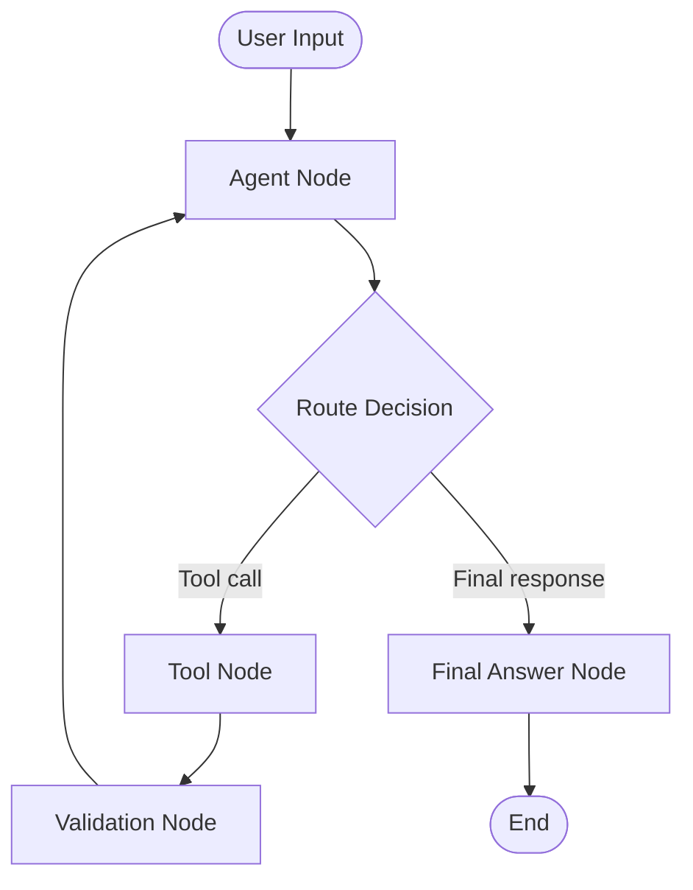

# Clinical Case Investigation Agent

## Live Demo

[Open the Clinical Case Investigation Agent](https://clinical-case-agent-hprsmthe5cyheky74cnqsv.streamlit.app/)


An experimental AI-powered clinical research assistant designed to support structured case investigation, medical evidence retrieval, and preliminary exploration of potential medication interactions.

The application uses LangGraph to coordinate an LLM-based agent and its tools, with a Streamlit interface for submitting cases and reviewing structured results.

> **Important:** This project is an educational and research prototype. It is not a medical device and must not be used to diagnose conditions, prescribe treatments, or make medication decisions.

## Features

- **Agentic workflow:** Uses LangGraph to let the agent decide when to call available tools and when to produce a final response.
- **Medication interaction exploration:** Checks recognized medication pairs against a small local demonstration interaction database.
- **PubMed evidence retrieval:** Searches medical literature through the NCBI Entrez E-utilities API.
- **Structured investigation:** Organizes tool outputs, evidence details, limitations, and case-relevant context.
- **Source traceability:** Displays retrieved publication information and PubMed links when available.
- **Streamlit interface:** Provides a workspace for submitting clinical case descriptions and reviewing investigation results.
- **Bounded tool execution:** Limits the agent's tool-calling loop to help prevent uncontrolled iterations.

## Architecture

The application uses a LangGraph state graph to coordinate the investigation workflow.



### Workflow components

1. **Agent Node:** Processes the case and decides whether additional information or tool execution is needed.
2. **Tool Node:** Executes the selected tool calls.
3. **Validation Node:** Validates and processes tool results before returning control to the agent.
4. **Final Answer Node:** Produces the final investigation response.

The agent can perform multiple tool calls when needed. The maximum number of tool iterations is currently limited to four.

## Available Tools

### 1. Medication Interaction Checker

`check_drug_interactions`

This tool:
- Extracts recognized medication names and supported aliases.
- Checks medication pairs against a local demonstration database.
- Returns structured results, including detected medications, interaction status, evidence text, limitations, and next steps.

The currently supported medication names include:

- Acetaminophen (including paracetamol and Tylenol)
- Aspirin (including Bayer)
- Warfarin (including Coumadin and Jantoven)
- Simvastatin (including Zocor)
- Clarithromycin (including Biaxin)
- Loratadine (including Claritin)
- Amoxicillin (including Amoxil)

The local demonstration database currently contains two example interactions:

- Warfarin + Aspirin
- Simvastatin + Clarithromycin

**Limitation:** This is a small educational demonstration database, not a live, comprehensive, or clinically validated drug interaction database. An interaction not found in this database must not be interpreted as evidence that a medication combination is safe.

### 2. Medical Evidence Search

`search_medical_evidence`

This tool searches PubMed using the NCBI Entrez E-utilities API.

It supports:
- Constructing focused literature search queries.
- Retrieving relevant publication metadata.
- Extracting available article information.
- Considering case context, such as patient age and pregnancy status, when provided.
- Returning publication identifiers and source links where available.

The application applies heuristic relevance logic to retrieved results.

**Limitation:** Search results and relevance ordering are not a systematic review, clinical guideline assessment, or validated evidence-quality appraisal. Retrieved publications require independent review.

## Technology Stack

| Component | Technology |
|---|---|
| Programming language | Python |
| User interface | Streamlit |
| Agent orchestration | LangGraph |
| LLM integration | LangChain OpenAI integration |
| LLM provider | OpenRouter |
| Configured model | `qwen/qwen3.7-plus` |
| Medical literature | PubMed / NCBI E-utilities |
| HTTP requests | Requests |
| Testing | Pytest |

## Project Structure

```text
clinical-case-agent/
│
├── graph_app.py
│   └── LangGraph workflow, agent logic, tools, and validation
│
├── streamlit_app.py
│   └── Streamlit user interface
│
├── requirements.txt
│   └── Project dependencies
│
├── test_graph_app.py
├── test_integration.py
├── test_routing.py
├── test_drug_interaction_pairs.py
├── test_medication_extraction.py
├── test_pubmed.py
│   └── Automated tests
│
├── .streamlit/
│   └── secrets.toml (local configuration; do not commit)
│
└── README.md
```

## Getting Started

### Prerequisites

- Python 3.10 or later
- pip
- An OpenRouter API key
- Internet connection for OpenRouter requests and PubMed searches

### 1. Clone the repository

```bash
git clone https://github.com/ShahdFayezNegm/clinical-case-agent.git
cd clinical-case-agent
```

### 2. Create a virtual environment

**Windows PowerShell:**

```powershell
python -m venv venv
.\venv\Scripts\Activate.ps1
```

**Linux / macOS:**

```bash
python3 -m venv venv
source venv/bin/activate
```

### 3. Install dependencies

```bash
pip install -r requirements.txt
```

### 4. Configure the OpenRouter API key

Create the Streamlit secrets directory if it does not already exist:

```powershell
New-Item -ItemType Directory -Force .streamlit
```

Create `.streamlit/secrets.toml` with the following content:

```toml
OPENROUTER_API_KEY = "your-openrouter-api-key"
```

Alternatively, set the environment variable.

**Windows PowerShell:**

```powershell
$env:OPENROUTER_API_KEY = "your-openrouter-api-key"
```

Never commit API keys or other secrets to GitHub.

### 5. Run the application

```bash
streamlit run streamlit_app.py
```

Streamlit will display a local URL in the terminal. Open that URL in your browser to access the application.

## Running Tests

Install Pytest if it is not already installed:

```bash
pip install pytest
```

Run the complete test suite:

```bash
python -m pytest -q
```

The tests cover application logic, agent routing, medication extraction, interaction checking, PubMed functionality, and integration scenarios.

Integration tests use controlled test doubles and mocked external requests where applicable; they do not require a real OpenRouter API call for every test.

## Example Investigation Scenario

The following is a fictional example of a case that can be submitted to the application:

> A 65-year-old male patient is taking warfarin for atrial fibrillation. His physician is considering adding low-dose aspirin because of a cardiovascular concern.
>
> Investigate the potential medication interaction, retrieve relevant PubMed evidence, assess the relevance of retrieved publications to the case, and identify limitations and questions requiring human clinical review.
>
> Do not provide a diagnosis or recommend changing medication.

The application can use its medication interaction tool and PubMed search tool to gather information for a structured investigation.

## Limitations and Safety

This project is an experimental AI prototype designed to support clinical case investigation through medical literature retrieval and medication interaction checking.

Its current scope has several limitations:

- The medication interaction checker uses a predefined local database with limited medication coverage and aliases.
- Medical evidence is retrieved from PubMed, so search results may not include every relevant publication.
- Evidence ranking and case-relevance assessments use heuristic methods.
- AI-generated explanations require verification against the original research publications.

The system is intended to assist with organizing information and exploring medical evidence. It does not provide diagnoses, prescriptions, or treatment recommendations. All findings require qualified healthcare professional review.

## Privacy and Data Handling

The application uses Streamlit session state to temporarily maintain the current case question and investigation result during an active session. It does not intentionally store clinical cases in a local database.

External services are used for the following operations:

- **OpenRouter:** Processes case information through the configured language model.
- **NCBI PubMed:** Retrieves medical literature based on the investigation queries.

For privacy and data protection, users should submit fictional or properly anonymized cases only. Personal identifiers and confidential patient information should not be entered.

Data processing is also subject to the privacy and data-handling policies of the external services.

## Disclaimer

This project is developed for educational and research purposes. It is a prototype for AI-assisted clinical case investigation and is not intended for independent clinical decision-making. Professional healthcare review is required before any clinical use of the information it produces.
## About Me

**Shahd Fayez Negm**

Computer Science and Artificial Intelligence graduate interested in AI Engineering, Machine Learning, and building practical AI applications.

- **GitHub:** [ShahdFayezNegm](https://github.com/ShahdFayezNegm)
- **LinkedIn:** [LinkedIn Profile](https://linkedin.com/in/shahd-fayez-70b9a331b)
## License

This project is licensed under the [MIT License](LICENSE).
